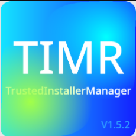
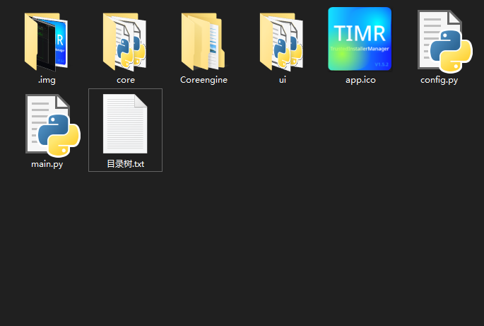

<div align="center">
  

  # TIMR (TrustedInstallerManager)

  **一款现代化、高效率的 Windows 权限管理与进程强杀工具**

  [](#)
  [](#)
  [](#)
  [](#)
  [](https://github.com/yunlilun/TrustedInstallerManager_TIMR/releases)
</div>

---

## 简介

**TIMR** 是由 [@YUNLI](https://github.com/yunlilun) 开发的一款完全开源的 Windows 系统工具。它不仅是一个简单的文件/文件夹提权工具，更集成了现代化的 UI 渲染引擎和高级的进程强杀机制。

无论你是遇到顽固无法删除的系统级文件，还是需要处理占用资源且无法被任务管理器结束的流氓软件，TIMR 都能为你提供最高效的解决方案。

## 界面预览

<div align="center">
  
  &nbsp;&nbsp;&nbsp;&nbsp;
  
</div>

## 下载

请前往 **[Releases](https://github.com/yunlilun/TrustedInstallerManager_TIMR/releases)** 页面下载最新版本。

> 由于程序涉及系统底层操作，部分安全软件（如 Windows Defender、360、火绒）可能会误报拦截。这是所有提权工具的普遍现象，并非恶意代码。请将程序加入信任区或白名单后使用。

## 核心特性

- **双重强杀引擎**：内置原生 `taskkill` 引擎，同时集成了微软官方 Sysinternals `PsExec` 引擎。当普通管理员权限无法结束时，可自动降级或手动切换至 SYSTEM 级权限强杀。
- **深度文件提权**：基于 UAC 与 `takeown` / `icacls`，暴力夺取任意文件的 TrustedInstaller 级所有权。
- **现代化 UI 引擎**：完全抛弃 Tkinter 原生组件，采用纯 Canvas 手绘实现带抗锯齿的平滑圆角按钮、平滑过渡的主题色动画，以及无边框圆角窗口。
- **全局窗口置顶**：内置 Win32 API 强占 Z-Order 刷新机制，可将主窗口压制在绝大多数软件（包括部分安全软件）之上。
- **内置任务管理器**：提供深层进程列表检测，支持实时搜索、查看 PID 和内存占用，并可一键结束进程（全程防 CMD 黑框）。
- **启动与环境自检**：启动时自动渲染 `Start.png` 并静默检测运行环境、核心依赖和引擎文件完整性。

## 技术原理与边界

### 1. 关于“获取 TrustedInstaller 权限”
本程序并非通过底层漏洞“窃取” TI 的 Token。而是通过请求管理员 UAC 提权后，调用 `takeown` 和 `icacls` 强制修改文件的所有者（将所有者从 TrustedInstaller 改为 Administrators 组），从而获得完全控制权。

### 2. SYSTEM 级强杀 (PsExec 引擎)
当遇到顽固进程时，TIMR 会调用 `PsExec64.exe`。其原理是利用 Windows 的 SCM（服务控制管理器），在后台临时注册并启动一个名为 `PSEXESVC` 的系统服务（SYSTEM 权限），借此身份对目标进程执行强制终结操作，随后自动清理。

### 3. 关于 PPL (受保护进程轻量级) 的边界
部分安全软件（如火绒、360）的核心进程受 Windows 内核 **PPL** 机制保护。
* **TIMR 无法结束这些进程**：因为任何用户态程序（包括任务管理器甚至 SYSTEM 权限）都无法强行跨越 PPL 内核屏障。
* **为什么不集成“漏洞驱动 (BYOVD)”？**：虽然使用第三方易受攻击的驱动加载到内核可以绕过 PPL，但这种行为极易导致系统蓝屏（BSOD），且会被全球所有杀毒软件直接判定为勒索木马并永久拉黑。TIMR 坚守安全底线，纯用户态运行。

## 编译与打包指南

为确保核心引擎（PsExec）和图片资源被正确打包，**请不要直接使用普通的 pyinstaller 命令**。

1. 确保安装了依赖：
   ```bash
   pip install -r requirements.txt
